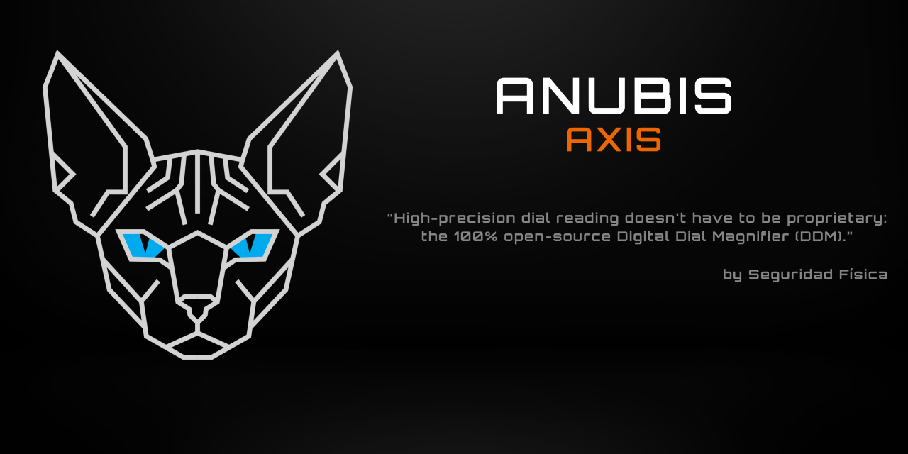
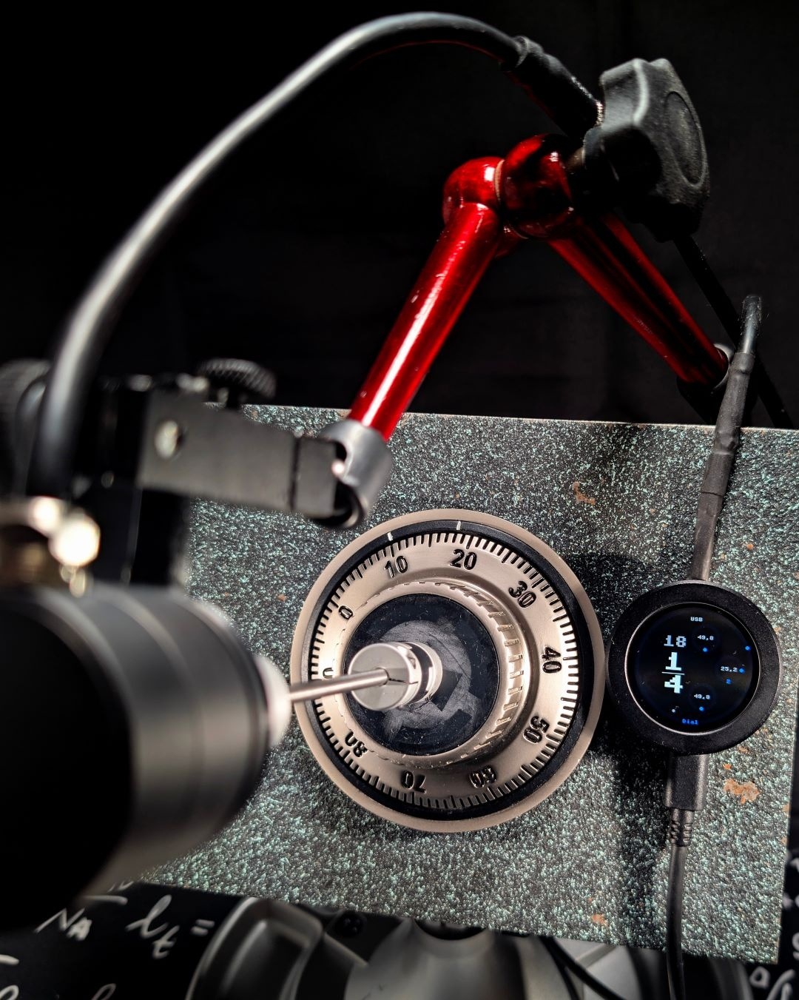
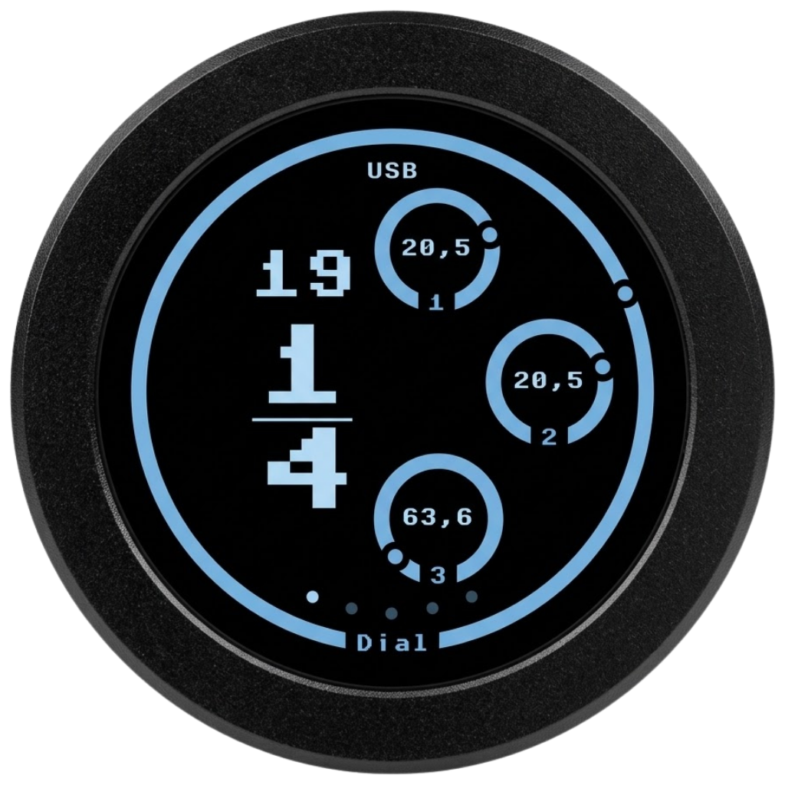

# Anubis Axis

**An open tool for precision dial measurement.**

Created for the locksport community and locksmithing professionals.

[Discover the project](#what-is-anubis-axis) · [Features](#built-for-practice) · [Contribute](#made-by-and-for-the-community)

---

  
  
<em>A tool to observe every turn of your dial.</em>

## What is Anubis Axis

Anubis Axis measures the rotation of a dial and displays the reading on a circular touchscreen. It combines a magnetic encoder with a Raspberry Pi Pico 2 to offer a tool you can study, build, and adapt to your own setup.

The project was created by a community member and founder of the **Seguridad Física** channel, with one simple idea: share an open tool and grow through the contributions of those who use it.

## Built for practice

- **Precise readings:** 4096 positions per revolution, with an approximate resolution of 0.088° per step.
- **Multiple ways to measure:** raw readings or fractional-turn readings, plus simulation of three- and four-wheel positions.
- **An interface tailored to you:** touchscreen, zero calibration, light and dark themes, adjustable brightness, and text in Spanish and English.
- **Flexible and open:** USB or battery power, with code available to study and improve.

  
  
<em>Dial reading and three-wheel simulation on the circular screen.</em>

## Made by and for the community

Anubis Axis is an open project under active development. If you have an idea, find an issue, or want to share an improvement, open an issue or submit a pull request. Contributions are welcome!

The project code is available in [`src/`](src/). Technical documentation, assembly instructions, and configuration details will be moved to the project wiki.

---

> [!WARNING]
> **Practice responsibly:** use Anubis Axis only on your own locks or on locks you are authorized to work on. Common sense, permission, and good faith come first.
